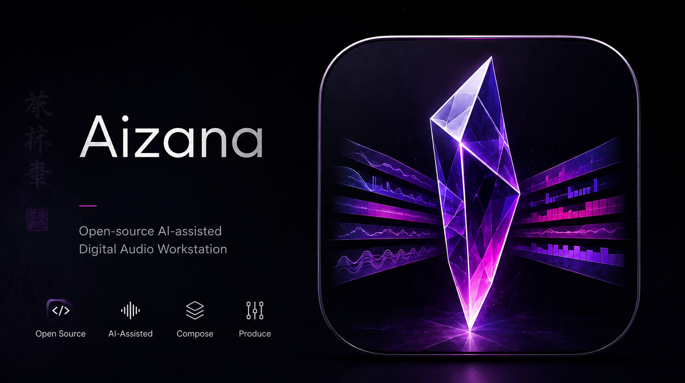

<p align="center"></p>

# Aizana

**English** | [Deutsch](README.de.md)

Aizana is an open-source, mixing-focused DAW for macOS. It includes recording,
audio and MIDI editing, comping, buses, FX sends and export. The interface is
currently in German. AI features are optional tools; recording and mixing do
not require an AI account.

[User manual](MANUAL.md) ·
[First launch](docs/ALPHA_INSTALL.md) ·
[Features](#features) ·
[Build from source](#build-from-source) ·
[Licensing and contributions](#licensing-and-contributions)

## How Aizana began

I am an audio engineer with a background in music, not software development.
Aizana started with a personal question: how far could I get by combining my
audio experience and ideas for a DAW with the possibilities of AI?

That curiosity turned into months of work. I developed the project on my own
with AI assistance, tried ideas, tested results, tracked down bugs and reworked
many things. AI helped me with the technical implementation. My own experience
making music guided what the program should become and how it should feel to use.

Aizana builds on existing open-source projects. Without those developers' work,
it would not have been possible in this form. The components, their authors and
their respective licenses are documented in this repository.
I would also like to thank you for your work and for making it available as
open source.

I am sharing Aizana and its source code for free to show what can grow out of a
personal experiment like this. If you make music, are curious about the technology
or want to develop it further, you are welcome to try it and get involved under
the applicable licenses.

Aizana is my hobby project, and I am happy to share the result with you.

## My vision: more time for music

With Aizana, I want to explore how people and AI can work together when making
music. The creative intention, listening and decisions stay with the person.
Assistance should reduce repetitive work, speed up tasks and help you stay in
your creative process longer. You decide how much help to use: work entirely by
hand, delegate individual steps or use an initial mix suggestion as a starting
point.

There are two different entry points:

- **KI-Mix** (AI Mix) uses built-in analysis and mixing rules to create a
  suggestion, without a Claude or Codex account. Beginners can use it to explore
  levels, processing and routing, compare results and continue from there.
  Pro mode lets you review the suggestion before applying it; Beginner mode
  applies it directly. Changes can be undone. The suggestion is a starting point
  for learning and listening comparisons.
- **KI-Studio** (AI Studio) can connect your installed Claude Code or Codex tools
  to the open session. Describe a specific task in words, such as “Put a de-esser
  on my lead vocals,” “Add some reverb to the backing vocals,” or “Route my drum
  tracks to a bus and add a compressor to it.” The assistant can use the available
  mixing tools to carry out these tasks. Listen to the changes and adjust them;
  individual operations can be undone. Setup and available tools are described
  in the [AI Studio guide](docs/MCP.md).

When **importing stems with KI-Setup**, Aizana can use filenames and audio
analysis to recognize instrument groups and suggest assignments such as vocals,
drums, bass, guitars or keys. It also provides routing and initial level
adjustments. Pro mode lets you review and correct the assignments before applying
them; Beginner view applies them directly. This organizes existing individual
tracks. It is separate from the optional tool that splits a finished mix into
stems.

Experienced users can leave all assistance features unused and operate Aizana
as a conventional DAW. The workflow between those extremes is what interests me
most: I set the direction and delegate specific tasks that would otherwise take
me away from making music.

## Project status and overview

**Free and open source:** Aizana's source code is available for building, using
and developing further at no charge. Original Aizana code is GPL-3.0-or-later;
dependencies retain their license conditions, including JUCE under AGPLv3.
The included license texts and third-party notices continue to apply.
See [licensing and obligations](docs/OPEN_SOURCE_LICENSING.md).

**Status: 0.3.0 Alpha, undergoing final checks.** The current source includes
recording, saving, comping, MIDI editor and mixer fixes, as well as the new insert
chain management. Outstanding checks are listed in [STATUS.md](STATUS.md).
A passing automated suite is not a complete hardware or plugin compatibility
claim. Back up important projects before changing versions.

## Getting Aizana from GitHub

Aizana 0.3.0 is provided exclusively as source code through this GitHub repository.
There is no DMG or prebuilt app download for this version. The
[build instructions](#build-from-source) describe the local build and its
dependencies.

The verified build targets **Apple Silicon (arm64), macOS 13.3 or later**.
A local build is not Developer ID signed or notarized. See
[First launch](docs/ALPHA_INSTALL.md) for startup instructions. Aizana does not
change Gatekeeper settings. Earlier release packages do not contain the current
state of `main`.

## Who Aizana is for

Aizana is for people who want to record their own music, edit existing tracks and
mix songs. Beginners and experienced users work with the same session; Beginner
and Pro views differ in presentation and the decisions they expose. Automatic
suggestions remain ordinary, inspectable DAW edits with undo support.

Start with an empty session and record, or import existing individual tracks.
Arrange the music on the timeline, then use the mixer to adjust sound, levels
and signal paths. Export the finished mix as an audio file. This workflow needs
neither an AI subscription nor additional model weights.

Assistance features extend this workflow: KI-Setup helps organize existing
tracks, KI-Mix creates a rule-based mix suggestion, and optional stem separation
splits a finished mix. These are three independent tasks.

### Which guide should I use?

| Your goal | Start here |
|---|---|
| Build and launch Aizana for the first time | [Build instructions](#build-from-source) and [First launch](docs/ALPHA_INSTALL.md) |
| Import, edit and mix a song | [User manual](MANUAL.md), chapters 2–8 |
| Record a microphone or instrument | [Recording](MANUAL.md#4-recording) |
| Automatically organize existing stems | [KI-Setup](MANUAL.md#10-ai-setup-for-existing-individual-tracks) |
| Split a mixed file into instrument groups | [Stem separation](MANUAL.md#12-separating-a-song-into-stems) |
| Produce finished audio files | [Export](MANUAL.md#14-exporting-a-mix-and-tracks) |
| Investigate a problem | [Troubleshooting](MANUAL.md#16-troubleshooting) |
| Redistribute code or the model | [Licensing overview](docs/OPEN_SOURCE_LICENSING.md) and [Distribution](docs/DISTRIBUTION.md) |

## Recent improvements

- Select mixer channels on empty strip areas without changing gain or pan.
  Drag pan horizontally on the knob; control clicks preserve multiple selection.
- Reorder audio/instrument tracks in the mixer and duplicate complete tracks
  from context menus, including clips, effects, automation and output routing.
- Resize the mixer from its upper boundary.
- Show automation, choose parameters and select Read/Touch/Latch/Write from the
  track-header context menu; the existing A button remains available.
- Export MP3 mixdowns and stems with the built-in encoder.

See the [manual](MANUAL.md) for gestures, the [change log](CHANGELOG.md) for
changes and [test status](STATUS.md) for verified coverage and remaining checks.

## Features

| Area | Included features |
|---|---|
| Recording | Multitrack audio, input selection, monitoring, count-in, metronome, punch in/out, loop takes and comping |
| Arrangement | Clip selection and multiselection, moving, splitting, trimming, fades/crossfades, clip gain, gain envelopes, edit groups and joining |
| Audio editing | Bounce in place, time-stretching, transient detection, warp markers and key-based offline pitch correction |
| Tempo | Tempo and time-signature changes, grid, quantization, tempo estimation from audio |
| MIDI | Piano roll, note length, velocity, controller lane, quantization strength, swing and scale reference |
| Mixer | Audio, bus, FX and master channels, sends, bus routing, VCA groups, sidechain, mute/solo, pan and levels |
| Displays | Peak/RMS/LUFS, EQ spectrum, waveforms and playhead |
| Inserts | Individual plugin and chain copying, moving, reordering, bypass, bulk removal, presets and explicitly loaded default presets |
| Automation | Plugin and mixer parameters with Read/Touch/Latch/Write; track-header menu for lane visibility, parameter and mode selection |
| Instruments | Aizana Synth with two oscillators and presets; Aizana Drums with an 8×16 sequencer and custom WAV samples |
| Effects | EQ with band dynamics, compressor, reverb, limiter, de-esser, delay, gate and saturator |
| Plugin hosting | VST3, Audio Units on macOS and CLAP; install external plugins separately |
| Export | Stereo mixdown and individual tracks as WAV/AIFF at 44.1/48/96 kHz and 16/24/32 bits, or MP3 at 44.1/48 kHz and 128/192/256/320 kbit/s (built-in LAME encoder) |
| Session management | Saving, media folders, autosave, backups and recovery |
| Assistance | KI-Setup for existing stems, rule-based KI-Mix, reference analysis, optional local stem separation and KI-Studio |

Separate hardware cue outputs and experimental out-of-process hosting have their
own testing limits. This table describes implemented features, not universal
device or plugin compatibility.

## Start a project in a few steps

Menu names below match the current German interface.

1. Create a new session and choose its name and location with **Datei → Speichern
   unter…** (File → Save As). Load an existing session with **Datei → Session
   öffnen…** (File → Open Session).
2. Drag audio files into the arrangement or use **Datei → Audio importieren…**
   (File → Import Audio). Multiple files can be placed on separate tracks.
3. To record, select an input in the track header, arm **REC**, and enable
   monitoring **I** if needed. Then start recording from the transport.
   macOS manages microphone permission.
4. Open the console with **Mix** and set levels and pan. Buses combine track
   outputs; FX channels receive signals through sends.
5. Use **Export** to render a mixdown or stems. Check the range, file format,
   sample rate, bit depth, mute/solo states and master effects before exporting.

## Editing and comping

- Select and move clips, trim their edges, and use the fade handles to fade in
  or out. Tools are available at the top of the arrangement.
- Command-click adds to or removes from a selection. Selecting track headers and
  selecting clips are separate operations.
- Command-Z undoes edits; Command-Shift-Z redoes them.
- Loop recording creates takes. In the take view, combine sections of different
  takes into a comp. Select a whole take for comparison; **Zusammengesetzt (Comp)**
  returns to the preserved comp.
- Double-click a MIDI clip to open the editor. The piano roll shows notes beside
  the keyboard, with a compact velocity lane below. Show the controller lane when
  needed. Notes can be drawn, moved, extended, deleted and quantized.

## Inserts and FX chains

Audio, bus, FX and master channels share the same insert area:

| Action | Result |
|---|---|
| Plus in the insert header | Open plugin selection |
| Double-click a plugin | Open its editor |
| Dot on the right of a plugin | Enable/disable that insert |
| Drag a plugin within the list | Change its order |
| Drag a plugin to another channel | Copy it with its settings |
| Drag the insert title to another channel | Copy the entire effect chain |
| Hold Alt/Option (⌥) when dropping on another channel | Move the existing instance or chain |
| Power button in the header | Enable/disable all effect inserts together |
| Arrow menu | Copy, paste, save, load or explicitly replace a chain |
| Alle entfernen (Remove all) | Remove the effect chain in one undoable operation |

Copying **appends** to the destination chain; replacing is a separate menu action.
Internal routing, volume and metering components, as well as instruments, remain
protected. The **default preset** is saved and loaded on request, not applied
automatically to new channels. Presets use the `.aizfxchain` extension.

Reusable copies retain parameters, order and bypass state. They do not copy
song automation tied to the timeline or external sidechain source references.
Move operations preserve the original instances and their connections. The new
interaction is implemented and automatically tested; cross-channel Alt/Option
dragging has also passed native interaction testing. Further testing limits are
listed in [STATUS.md](STATUS.md).

For experimental out-of-process plugins, the actual plugin interface opens
without an additional placeholder window. This has been tested with Fresh Air,
including parameter interaction and session switching; it is not a claim of
compatibility with every third-party plugin. Native out-of-process plugin windows
cannot be embedded in the docked editor panel.

## Common keyboard shortcuts

| Key | Action |
|---|---|
| Space | Start/stop playback |
| Command-S | Save session |
| Command-Z / Command-Shift-Z | Undo / redo |
| Command-T | Add track |
| Command-M | Toggle mixer |
| Command-E | Split at the playhead |
| Command-C / V / D | Copy / paste / duplicate clips |
| M / S | Mute / solo selected track(s) |
| R | Toggle record arm on the active track |
| C / Escape | Scissors / pointer tool |
| F | Automatically follow the playhead |

Text input takes priority over track and transport commands. Some commands depend
on the active view and selection.

## Files and backups

```text
My Song/
    My Song.tracktion
    My Song Audio/
        Comps/
        Bounces/
    Backups/
```

On first save, required recordings, including alternative takes, are collected
in the session's media folder. Before the first save, Aizana stores recordings
in the user's Music folder. Missing media is reported as an error. Autosave and
recovery complement explicit saving; read a recovery prompt before dismissing it.

## KI-Setup, KI-Mix and stem separation

Aizana includes a polyphonic synthesizer, a drum instrument with sequencer and
sampler, plus EQ with band dynamics, compressor, reverb, limiter, de-esser, delay,
gate and saturator. External plugins are hosted through VST3, Audio Units and
CLAP and must be installed separately; third-party plugins are not bundled.

**KI-Setup** works with existing individual tracks: filenames and audio analysis
help with instrument identification, grouping, routing and gain staging. It does
not split a mixed audio file and does not require stem model weights.

**KI-Mix** currently uses rules, not a bundled trained mixing model. It suggests
level, EQ, dynamics and routing changes. A reference file or genre profile can
supply additional target values. Results can be inspected and undone; listen to
the result rather than relying solely on automatic decisions.

**Stem separation** is a separate tool for splitting a finished audio file.
It runs locally using Roman Solovyev's (ZFTurbo) MIT-licensed MVSep-Mega model.
The [model release](https://github.com/OmniLightX/Aizana-DAW/releases/tag/stem-model-mega53-v1)
is published at the URL used by the app. Download access follows repository
visibility: while this repository is private, anonymous in-app download is not
available. First-use download without authentication remains to be verified
after the repository becomes public.
The optional model is approximately 355 MB and is checked for
size and SHA-256 before use. Six outputs are available: drums, bass, vocals,
guitar, piano and other as a residual signal; a four-category mode is also
available. Python is not required. Model weights are not part of the source
repository. Separation artifacts can occur, particularly with synthesized
keyboard sounds. Provenance, full MIT notices and limitations are documented in
[Stem model and validation](docs/OPEN_STEM_RELEASE.md).
KI-Studio can use locally installed Claude Code or Codex CLI tools; their accounts,
network access and privacy terms apply separately. There is no blanket promise
that data stays on your computer when using these agents.

The Faust plugin generator is integrated. Creating new plugins requires Faust
and the Apple Command Line Tools on your computer; the compiler is not shipped
with the app. Details: [AI Studio and MCP](docs/MCP.md).

## Build from source

Requirements: Apple Silicon, macOS 13.3+, Apple Command Line Tools (Clang),
CMake 3.25+, Git and Python 3 for the verification scripts; Faust for the plugin
generator. The build configuration uses C++20. Dependencies are downloaded during
configuration. Install the Apple Command Line Tools with `xcode-select --install`;
CMake and Faust must be available by name in the terminal. The first build needs
internet access and takes considerably longer than later incremental builds.

```sh
git clone https://github.com/OmniLightX/Aizana-DAW.git
cd Aizana-DAW
git submodule update --init extern/JUCE extern/tracktion_engine
cmake -S . -B build -DCMAKE_BUILD_TYPE=Release -DAIZANA_UITEST_HOOK=OFF
cmake --build build --target Aizana engine_tests oop_host_smoke -j4
python3 tests/test_recording_patch.py
python3 tests/test_state_patch.py
ctest --test-dir build --output-on-failure
```

App: `build/Aizana_artefacts/Release/Aizana.app`. The generator and ONNX are enabled
by default when the required tools are available. `AIZANA_BUILD_GENERATOR=OFF`
or `AIZANA_ENABLE_ONNX=OFF` produce reduced builds. They do not have the full
release's functionality. The UI test hook must never be enabled in distributed
builds. Versioned Tracktion patches are checked and applied during configuration.
A differing local dependency state is not overwritten.

Open the app through Finder or run:

```sh
open build/Aizana_artefacts/Release/Aizana.app
```

For diagnostics, create a separate Debug build and test it with CTest as well.
The normal Aizana app must be closed because these runs share device settings.
Third-party tests require explicitly selected local plugins; see the
[test report](docs/TESTING.md). Old sessions and generated plugins
from the earlier Cloudes version remain supported. Legacy file-format and
migration identifiers needed for this compatibility remain in the code.

## Licensing and contributions

Community versions may retain the Aizana name and logo, including commercial
versions, with clear origin, modification and maintainer identification.
See [name and logo permissions](docs/BRANDING.md).

Original Aizana code: **GPL-3.0-or-later**. The combination with JUCE uses the
AGPLv3 open-source route; Tracktion and other components retain their own
licenses. See [LICENSE.md](LICENSE.md),
[THIRD_PARTY_NOTICES.md](THIRD_PARTY_NOTICES.md) and
[Distribution](docs/DISTRIBUTION.md) for source code and obligations.
Using a GPL/AGPL DAW does not automatically place your own songs under its
software license.

### Why do some dependencies mention “Commercial”?

JUCE and Tracktion each offer two alternative licensing routes. **Aizana uses
the open-source route here:** JUCE under AGPLv3 and Tracktion under
GPL-3.0-or-later. The respective vendor's alternative commercial license is not
needed for this route. It does not impose a purchase requirement on Aizana users.
Original license texts are preserved in full, including the alternatives they
describe.

| Component | License used here |
|---|---|
| Original Aizana code | GPL-3.0-or-later |
| JUCE 8 | AGPLv3 |
| Tracktion Engine | GPL-3.0-or-later |
| MVSep Mega 53 model weights and relevant model implementation | MIT; specific provenance and modifications are documented in the model report |
| ONNX Runtime, libebur128, CLAP and other components | MIT and included third-party notices |
| LAME 3.100 (MP3 encoder) | LGPL-2.0-or-later; original source and license texts included |
| SoundTouch | LGPL-2.1-or-later |
| Eigen (within the ONNX Runtime notices) | MPL-2.0; no separate Eigen build dependency |
| Catch2 (tests) | BSL-1.0 |

This is an overview, not a replacement for the full texts in [licenses/](licenses/),
[COPYING](COPYING), [COPYING.AGPL](COPYING.AGPL) and
[THIRD_PARTY_NOTICES.md](THIRD_PARTY_NOTICES.md). Redistribution and modifications
must preserve license and copyright notices and change notices, and meet the
applicable source-code obligations.
Apple build tools, optional AI services and separately installed plugins are
obtained separately and are not covered by Aizana's project license.

External pull requests are currently not accepted. Bug reports with a version
number and reproducible steps are welcome. Forks and modifications are permitted
under the license. Technical guidance is in [CONTRIBUTING.md](CONTRIBUTING.md).

## Reporting bugs and trying the alpha

For a useful bug report, include the Aizana version or commit, macOS version,
audio device and steps that reproduce the problem. For plugin issues, include
the plugin's format and version. Describe what you expected and what happened.

Check screenshots, logs and example sessions for personal information before
sharing them. Only use audio you have permission to share. Credentials, license
keys and private recordings do not belong in public bug reports. The
[user manual](MANUAL.md) includes initial troubleshooting steps.
